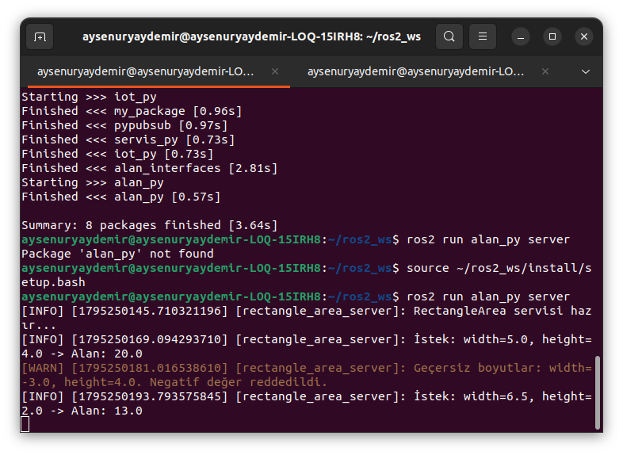
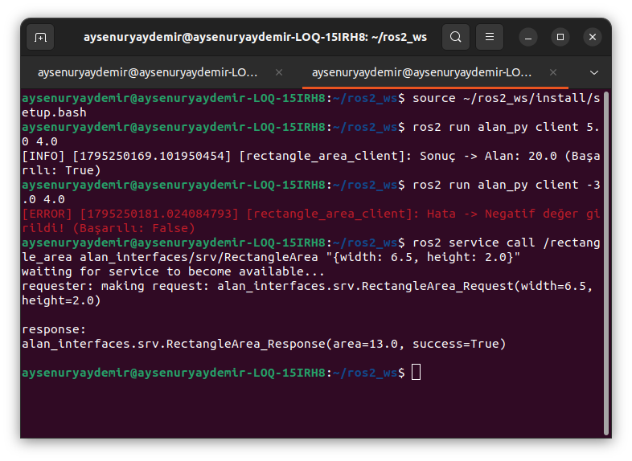

# RectangleArea Servisi (ROS 2)

Bu proje, ROS 2 kullanılarak geliştirilen ve dikdörtgenin alanını hesaplayan bir servis uygulamasıdır. Uygulama, servis sunucusu (Server) ve servis istemcisi (Client) mantığıyla çalışmaktadır.

Proje iki ROS 2 paketinden oluşmaktadır.

## 📦 Paket Yapısı

| Paket | Açıklama |
|---|---|
| `alan_interfaces` | RectangleArea.srv servis arayüzünü içerir. |
| `alan_py` | Python ile yazılmış servis sunucusu (area_server) ve istemci (area_client) düğümlerini içerir. |

## 📄 Servis Tanımı

**Dosya:** `alan_interfaces/srv/RectangleArea.srv`

```text
float64 width
float64 height
---
float64 area
bool success
```

- **İstek (Request):** Dikdörtgenin genişliği (`width`) ve yüksekliği (`height`).
- **Yanıt (Response):** Hesaplanan alan (`area`) ve işlemin başarılı olup olmadığını belirten (`success`) değeri.

**Alan hesaplama formülü:**

```text
area = width × height
```

## ⚙️ Kurulum ve Derleme

Öncelikle ROS 2 çalışma alanına gidilir:

```bash
cd ~/ros2_ws
```

Paketler aşağıdaki komutla derlenir:

```bash
colcon build --packages-select alan_interfaces alan_py
```

Derleme tamamlandıktan sonra ortam etkinleştirilir:

```bash
source install/setup.bash
```

**Not:** Her yeni terminal açıldığında aşağıdaki komut çalıştırılmalıdır:

```bash
source ~/ros2_ws/install/setup.bash
```

## 🚀 Uygulamanın Çalıştırılması

### 1. Servis Sunucusunu Başlatma

İlk terminal açılır ve aşağıdaki komut çalıştırılır:

```bash
source ~/ros2_ws/install/setup.bash
ros2 run alan_py area_server
```

Sunucu başarıyla başlatıldığında şu mesaj görüntülenir:

```text
RectangleArea Sunucusu hazır.
```

Sunucu, istemciden gelecek alan hesaplama isteklerini bekler.

### 2. Servis İstemcisini Çalıştırma

İkinci terminal açılır. İstemciye genişlik ve yükseklik değerleri parametre olarak verilir.

**Örnek:**

```bash
source ~/ros2_ws/install/setup.bash
ros2 run alan_py area_client 8.0 2.5
```

**Beklenen çıktı:**

```text
[INFO] [rectangle_area_client]: Alan (8.0 x 2.5) = 20.0
```

## 🔍 Servis Testleri

Servis, `ros2 service call` komutu kullanılarak doğrudan test edilebilir.

### Geçerli İstek

```bash
ros2 service call /calculate_rectangle_area alan_interfaces/srv/RectangleArea "{width: 6.0, height: 4.5}"
```

**Beklenen çıktı:**

```text
requester: making request: alan_interfaces.srv.RectangleArea_Request(width=6.0, height=4.5)

response:
alan_interfaces.srv.RectangleArea_Response(area=27.0, success=True)
```

### Geçersiz İstek

Negatif genişlik veya yükseklik değeri gönderildiğinde istek reddedilir.

```bash
ros2 service call /calculate_rectangle_area alan_interfaces/srv/RectangleArea "{width: -2.0, height: 5.0}"
```

**Beklenen çıktı:**

```text
requester: making request: alan_interfaces.srv.RectangleArea_Request(width=-2.0, height=5.0)

response:
alan_interfaces.srv.RectangleArea_Response(area=0.0, success=False)
```

## 🖥️ Terminal Ekran Görüntüleri

### Ekran 1: Servis Sunucusu

Sunucu terminalinde aşağıdaki işlemler gözlemlenir:

- Sunucu başlatıldığında `RectangleArea Sunucusu hazır.` mesajı görüntülenir.
- `width=6.0, height=4.5` isteği için alan 27.0 olarak hesaplanır.
- `width=8.0, height=2.5` isteği için alan 20.0 olarak hesaplanır.
- Negatif değer içeren istekler WARN seviyesinde loglanarak reddedilir.



### Ekran 2: Servis İstemcisi ve Servis Testleri

İstemci ve servis çağrısı terminalinde aşağıdaki işlemler gerçekleştirilir:

- `area_client 8.0 2.5` komutu ile 20.0 sonucu elde edilir.
- `area_client -3.0 4.0` komutu ile geçersiz istek testi yapılır.
- `ros2 service call` komutu ile geçerli ve geçersiz istekler test edilir.
- Geçerli isteklerde `success=True`, geçersiz isteklerde `success=False` sonucu alınır.



## ⭐ Bonus: Negatif Değer Kontrolü

Projeye ek olarak negatif boyut kontrolü gerçekleştirilmiştir.

**Sunucu tarafında:**

- `width` veya `height` değerlerinden herhangi biri negatifse istek reddedilir.
- Alan değeri `0.0` olarak döndürülür.
- `success=False` olarak ayarlanır.
- Sunucu terminaline WARN seviyesinde **"Geçersiz boyut reddedildi"** mesajı yazdırılır.

**İstemci tarafında:**

- İşlem başarılıysa hesaplanan alan INFO seviyesinde gösterilir.
- İşlem başarısızsa ERROR seviyesinde **"İstek reddedildi!"** mesajı gösterilir.

**Geçersiz istemci isteği:**

```bash
ros2 run alan_py area_client -3.0 4.0
```

**Beklenen çıktı:**

```text
[ERROR] [rectangle_area_client]: İstek reddedildi! (width=-3.0, height=4.0)
```

## 📌 Servis Bilgileri

| Özellik | Değer |
|---|---|
| Servis adı | `/calculate_rectangle_area` |
| Servis türü | `alan_interfaces/srv/RectangleArea` |
| Sunucu düğümü | `area_server` |
| İstemci düğümü | `area_client` |
| Programlama dili | Python |
| Robotik altyapı | ROS 2 |

## 🎯 Projenin Amacı

Bu proje ile ROS 2 üzerinde servis (Service) ve istemci (Client) yapısının kullanımı, özel servis arayüzü oluşturulması, 
düğümler arasında istek-yanıt iletişimi kurulması ve gelen verilerin kontrol edilmesi amaçlanmıştır.
